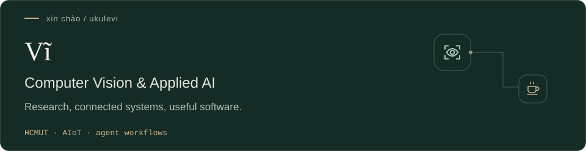

<h1 align="center"><b>Xin chao~ 👋</b></h1>

  

 

<picture>
  <source media="(max-width: 600px)" srcset="assets/profile-hero-compact.svg" />
  
</picture>

Computer Science at **HCMUT**, focused on Computer Vision and practical AI. I explore coding agents as tools for building software, with hands-on projects in medical imaging and AIoT.

[Work](#work) · [Now](#now) · [Workflow](#workflow) · [Contact](#contact)

### Work

<a href="https://github.com/ukulevi/traffic-agent-assistant">
  <picture>
    <source media="(max-width: 600px) and (prefers-color-scheme: dark)" srcset="assets/project-traffic-compact-dark.svg" />
    <source media="(max-width: 600px)" srcset="assets/project-traffic-compact.svg" />
    <source media="(prefers-color-scheme: dark)" srcset="assets/project-traffic-dark.svg" />
    
  </picture>
</a>

Traffic what-if decision-support MVP, with forecasting, simulation and human review.

<a href="https://github.com/ukulevi/lymphatic-vessel-segmentation">
  <picture>
    <source media="(max-width: 600px) and (prefers-color-scheme: dark)" srcset="assets/project-vision-compact-dark.svg" />
    <source media="(max-width: 600px)" srcset="assets/project-vision-compact.svg" />
    <source media="(prefers-color-scheme: dark)" srcset="assets/project-vision-dark.svg" />
    
  </picture>
</a>

Collaborative medical-image research. **My work:** Mean Teacher pipeline, data processing and results visualization.

<a href="https://github.com/ukulevi/rubyalert-aiot-lab">
  <picture>
    <source media="(max-width: 600px) and (prefers-color-scheme: dark)" srcset="assets/project-aiot-compact-dark.svg" />
    <source media="(max-width: 600px)" srcset="assets/project-aiot-compact.svg" />
    <source media="(prefers-color-scheme: dark)" srcset="assets/project-aiot-dark.svg" />
    
  </picture>
</a>

Lab monitoring with ESP32 sensors, a web dashboard and a Gemini-powered Telegram interface.

### Now

- **Research:** Computer Vision in my current specialization project (ĐACN).
- **Development:** brainstorming and building with Codex Desktop, Gemini and Hermes Agent.
- **Learning:** model deployment and operation in practical web applications.

### Workflow

The process I'm developing: **brainstorm → scope → build with agents → validate → iterate.**

### Contact

Open to conversations and collaboration around Computer Vision, Applied AI and AIoT.

[LinkedIn](https://www.linkedin.com/in/v%C4%A9-l%C3%AA-ho%C3%A0ng-ch%C3%AD-801198367/) · [Email](mailto:vi.lehoangchi@hcmut.edu.vn)

Good questions, useful software, Vietnamese coffee.
